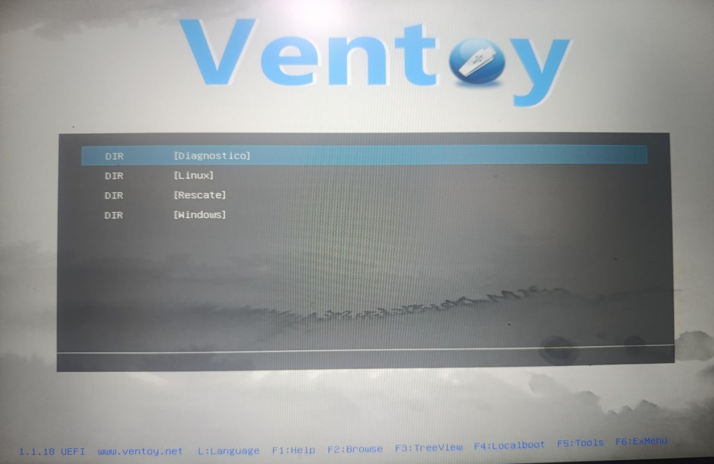
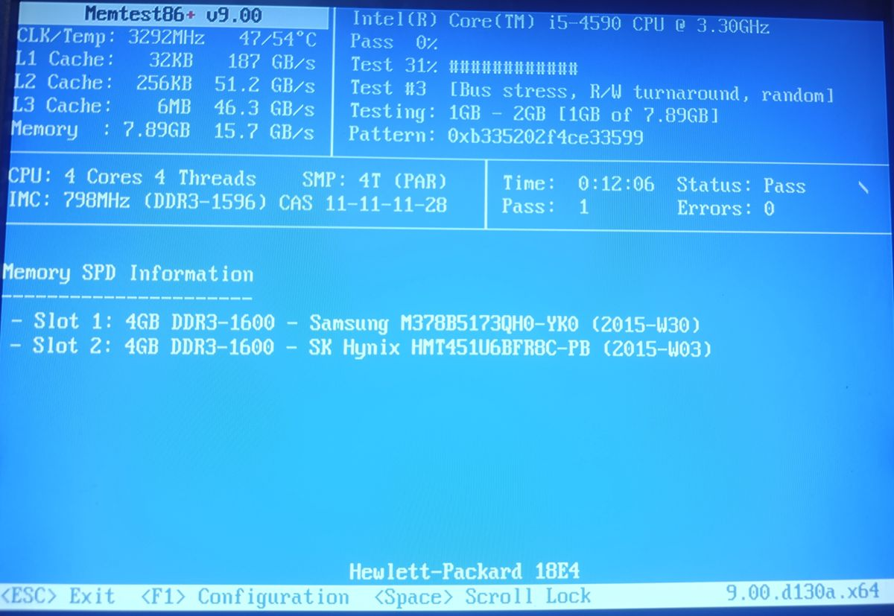
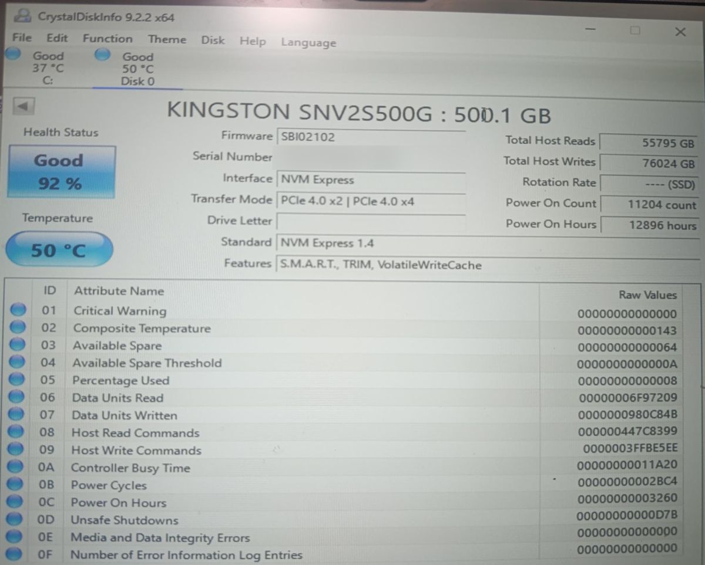
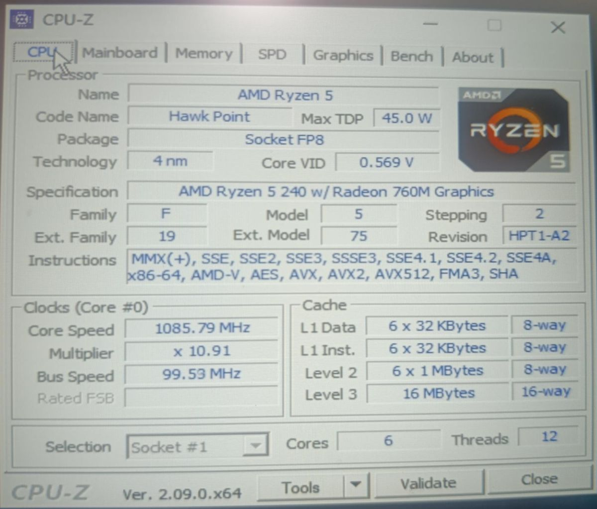
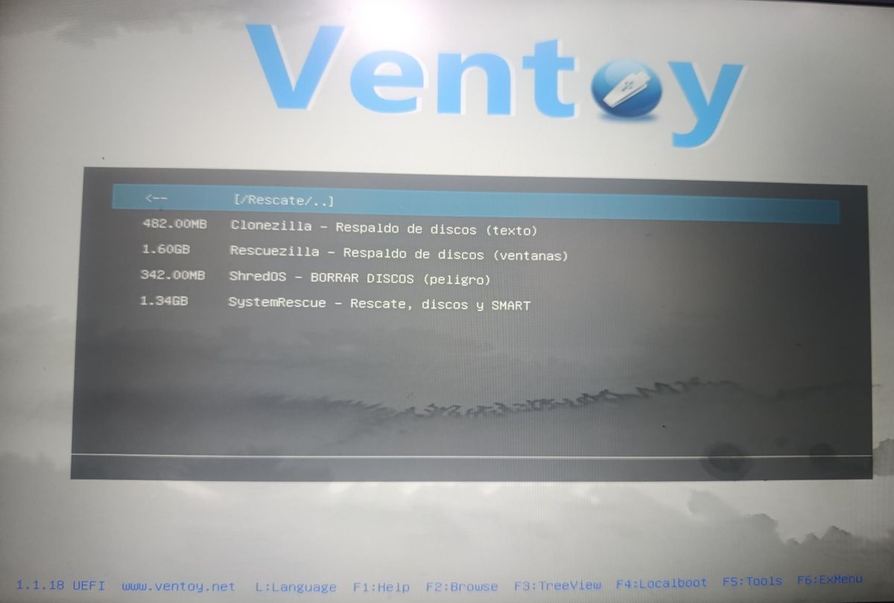

<div align="center">

# Ventoy Kit de Diagnóstico

**Una sola USB para revisar computadoras viejas, decidir qué piezas comprar, respaldar discos e instalar un servidor.**
Todo se prepara desde Linux.




</div>

---

## Por qué existe

Tenía varias computadoras viejas (una HP EliteDesk 800 G1 entre ellas) y quería convertirlas en un servidor casero con Ubuntu. Antes de comprar RAM o discos necesitaba saber **qué servía y qué no**. En vez de cargar varias USB, junté todo en una con Ventoy y documenté los pasos para poder repetirlo.

## Contenido

- [Qué incluye](#qué-incluye)
- [Resultados reales](#resultados-reales)
- [Inicio rápido](#inicio-rápido)
- [Guías](#guías)
- [Probado en](#probado-en)

## Qué incluye

| Carpeta | ISO | Para qué sirve |
|---|---|---|
| `Diagnostico/` | Memtest86+ | Probar la RAM |
| `Linux/` | Fedora Workstation Live | Revisar el equipo sin instalar nada |
| `Linux/` | Ubuntu Server LTS | Instalar el servidor |
| `Rescate/` | SystemRescue | Estado de discos (SMART), particiones |
| `Rescate/` | Clonezilla | Respaldo y clonado de discos (texto) |
| `Rescate/` | Rescuezilla | Respaldo y clonado de discos (ventanas) |
| `Rescate/` | ShredOS | Borrado seguro de discos |
| `Windows/` | Hiren's BootCD PE | CPU-Z, GPU-Z, HWiNFO, CrystalDiskInfo |

> [!NOTE]
> Las ISO no están en el repositorio. Cada una se descarga de su página oficial y se verifica con su checksum. Ver [guía 2](docs/02-isos.md).

## Resultados reales

<table>
  <tr>
    <td align="center"><br><sub>Memtest86+ en la HP 800 G1: 0 errores</sub></td>
    <td align="center"><br><sub>CrystalDiskInfo desde Hiren's: NVMe al 92 % de salud</sub></td>
  </tr>
  <tr>
    <td align="center"><br><sub>CPU-Z desde Hiren's: datos del procesador</sub></td>
    <td align="center"><br><sub>Carpeta Rescate con nombres y avisos de ventoy.json</sub></td>
  </tr>
</table>

## Inicio rápido

> [!CAUTION]
> Instalar Ventoy **borra todo** lo que tenga la USB. Confirma el dispositivo con `lsblk` antes de seguir.

```bash
lsblk -o NAME,SIZE,MODEL,TRAN          # identifica la USB (ej. sda)
sudo umount /dev/sda1 /dev/sda2        # "not mounted" está bien
sudo sh Ventoy2Disk.sh -i /dev/sda
```

Después:

1. Crea las carpetas y copia las ISO a la unidad **Ventoy**.
2. Copia [`ventoy/ventoy.json`](ventoy/ventoy.json) a `ventoy/ventoy.json` dentro de la USB.
3. Arranca el equipo desde la USB (en HP: **F9**).

## Guías

| # | Guía | Qué aprendes |
|---|---|---|
| 1 | [Instalar Ventoy](docs/01-instalar-ventoy.md) | Preparar la USB sin borrar el disco equivocado |
| 2 | [Descargar y verificar ISO](docs/02-isos.md) | Dónde bajar cada una y cómo comprobarla |
| 3 | [Organizar la USB](docs/03-organizar-usb.md) | Carpetas, menú en árbol y avisos con `ventoy.json` |
| 4 | [Leer diagnósticos](docs/04-leer-diagnosticos.md) | RAM, SMART, temperaturas y qué comprar |
| 5 | [Problemas frecuentes](docs/05-problemas.md) | Errores del instalador, arranque, discos |
| 6 | [Herramientas portables](docs/06-herramientas-portables.md) | WinDirStat y NirSoft desde Windows |

## Probado en

| Equipo | CPU | Notas |
|---|---|---|
| HP EliteDesk 800 G1 Tower | Intel Core i5-4590 | Arranque UEFI con Secure Boot desactivado |
| Acer Nitro V16 (ANV16) | AMD Ryzen 5 240 | Todas las ISO arrancan en modo normal |

¿Lo probaste en otro equipo? Abre un *issue* con el modelo y si funcionó.

## Licencia

Documentación bajo [MIT](LICENSE). Cada ISO pertenece a sus autores.
