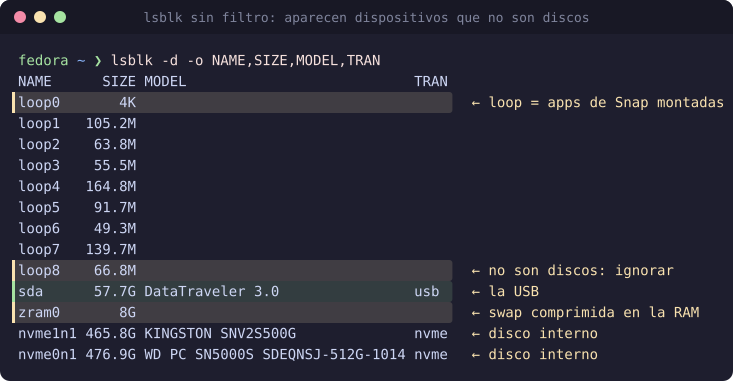
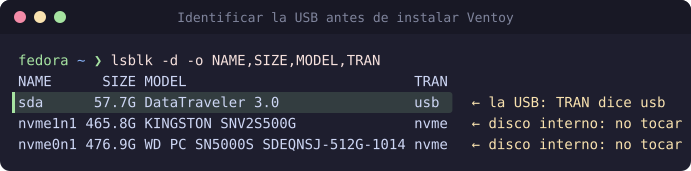
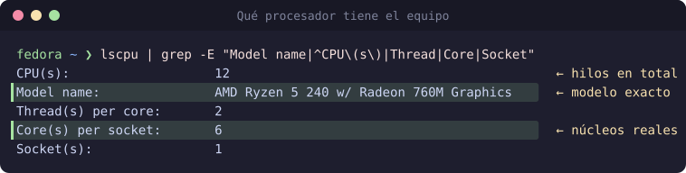
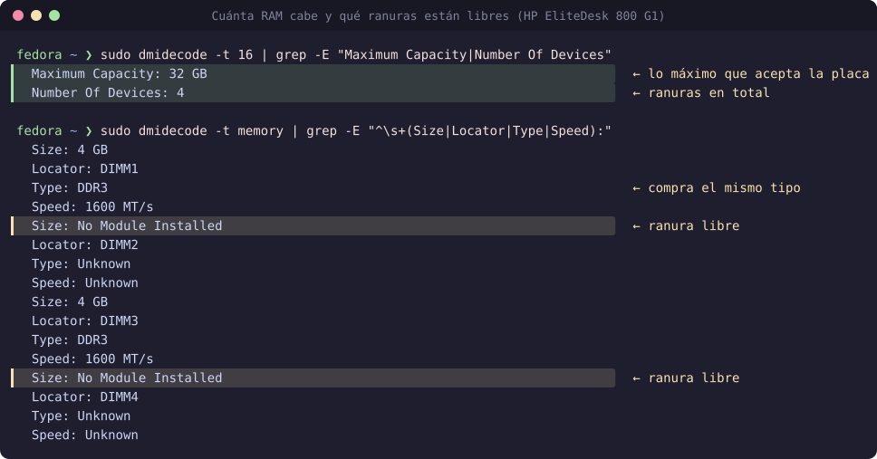
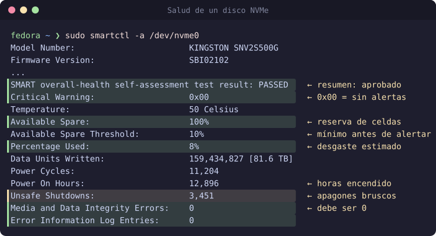

# 7. Ejemplos de terminal: cómo se ve y qué mirar

Cada ejemplo muestra el comando, lo que responde y **en qué fijarte**. Las líneas en **verde** son el dato que buscas o un valor sano; las **amarillas** son datos a vigilar o huecos aprovechables.

Puedes correr todos estos comandos desde **Fedora Live** o **SystemRescue**, sin instalar nada en el equipo.

> [!TIP]
> Los comandos con `sudo` solo **leen** información. Ninguno de esta página cambia nada en el equipo.

---

## 1. Identificar la USB

### Sin filtro: aparecen cosas que no son discos



Si corres `lsblk` tal cual, puede que veas una lista larga con nombres raros. **Ninguno de ellos es un disco:**

| Nombre | Qué es | ¿Lo puedo ignorar? |
|---|---|---|
| `loop0`, `loop1`… | Archivos que Linux monta como si fueran discos. Casi siempre son **apps de Snap**: cada una viene en un archivo comprimido que se "conecta" como disco de solo lectura. | Sí |
| `zram0` | **Memoria de intercambio comprimida dentro de la RAM.** Fedora la activa por defecto: cuando la RAM se llena, comprime datos en vez de mandarlos al disco. No ocupa espacio en ningún disco. | Sí |

Para confirmarlo en tu equipo:

```bash
snap list                    # las apps de Snap instaladas
losetup -l -O NAME,BACK-FILE # qué archivo hay detrás de cada loop
swapon --show                # zram0 aparece como swap
```

### Con filtro: solo discos reales



```bash
lsblk -d -I 8,259 -o NAME,SIZE,MODEL,TRAN
```

`-I 8,259` muestra solo discos SATA/USB (`sd…`) y NVMe (`nvme…`). Es el comando recomendado en todo el kit.

**Cómo leerlo**

- `-d` muestra solo los discos completos, sin particiones; así la lista es más corta.
- **`TRAN`** dice por dónde está conectado: `usb` es la memoria, `nvme` o `sata` son discos internos.
- **`SIZE`** confirma: una USB de 64 GB aparece como unos 57–58 G (el fabricante cuenta distinto).
- El nombre (`sda`, `nvme0n1`) **puede cambiar** entre arranques. En este mismo equipo, otro día el Kingston salió como `nvme0n1` y hoy como `nvme1n1`. Identifica siempre los discos por **modelo y tamaño** antes de un comando que borra.

> [!NOTE]
> Algunas laptops usan lectores de tarjeta o almacenamiento eMMC (`mmcblk0`). Si no ves tu disco con el filtro, quítale `-I 8,259` y búscalo en la lista completa.

---

## 2. Qué procesador tiene



**Cómo leerlo**

- **`Model name`** es lo que buscas en Google para saber el socket, la RAM máxima y si se puede cambiar por otro.
- **`CPU(s)`** son los hilos totales; **`Core(s) per socket`** son los núcleos reales. Si hay 2 hilos por núcleo, el procesador tiene *Hyper-Threading* (Intel) o *SMT* (AMD).

---

## 3. Cuánta RAM cabe y qué ranuras están libres



**Cómo leerlo**

- **`Maximum Capacity`**: el techo de la placa. No compres más de eso.
- **`Number Of Devices`**: cuántas ranuras hay en total.
- **`No Module Installed`**: ranura vacía, lista para ampliar.
- **`Type`**: DDR3, DDR4, DDR5… La RAM que compres **tiene** que ser del mismo tipo; no entra físicamente otra.
- **`Speed`**: si mezclas velocidades funciona, pero todo trabaja a la del módulo más lento.

En este ejemplo: hay 8 GB en 2 de 4 ranuras, y la placa acepta hasta 32 GB. Se pueden añadir dos módulos DDR3 sin quitar nada.

> [!NOTE]
> Los nombres de las ranuras (`DIMM1`, `ChannelA-DIMM0`…) cambian según el fabricante. Lo importante es contar las que dicen `No Module Installed`.

---

## 4. Salud de un disco NVMe



**Cómo leerlo**

| Línea | Valor sano | Qué significa |
|---|---|---|
| `test result` | `PASSED` | Resumen general del disco |
| `Critical Warning` | `0x00` | Cualquier otro valor es una alerta |
| `Available Spare` | Muy por encima del *Threshold* | Celdas de reserva para reemplazar las que fallan |
| `Percentage Used` | Bajo | Desgaste estimado. 100 % = vida de diseño cumplida, no muerte inmediata |
| `Media and Data Integrity Errors` | `0` | Errores reales al leer o escribir datos |
| `Unsafe Shutdowns` | Lo más bajo posible | Cortes de luz o apagados forzados |

En este ejemplo: el disco está **sano** (8 % de desgaste, 0 errores). Lo único a vigilar son los 3,451 apagados bruscos, que no lo dañaron pero son una buena razón para tener respaldos al día.

Para un disco SATA (HDD o SSD) el comando es `sudo smartctl -a /dev/sda` y la salida es una tabla distinta. Ahí revisa que estén en 0 `Reallocated_Sector_Ct`, `Current_Pending_Sector` y `Offline_Uncorrectable` (ver [guía 4](04-leer-diagnosticos.md)).

---

## Crear tus propias imágenes de terminal

Estas imágenes se generan desde archivos de texto en [`docs/terminal/`](terminal/) con el script [`tools/terminal-svg.py`](../tools/terminal-svg.py):

```bash
python3 tools/terminal-svg.py docs/terminal/lsblk.txt docs/img/terminal/lsblk.svg
```

Formato del `.txt`:

```text
title: Título de la ventana
$ comando que escribiste
salida normal
! línea en verde || comentario a la derecha
? línea en amarillo || otro comentario
```

Para añadir un ejemplo nuevo: corre el comando, copia la salida a un `.txt`, marca las líneas importantes y genera el SVG.
