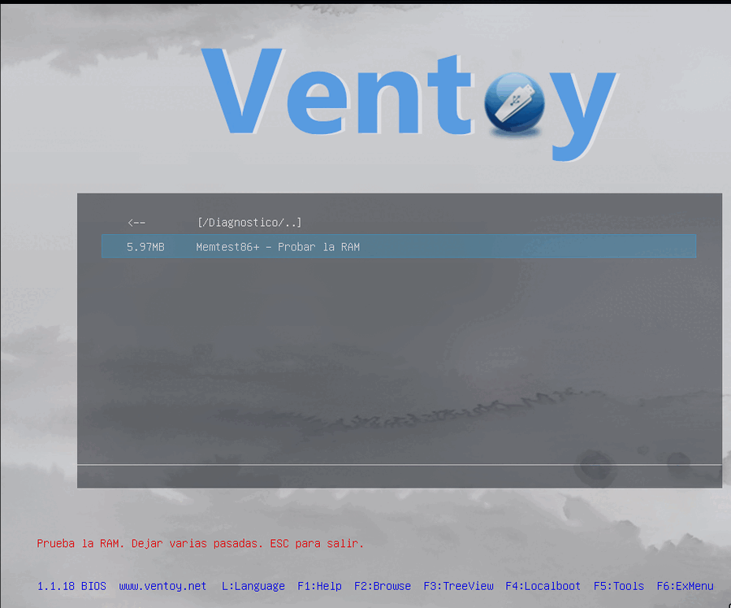
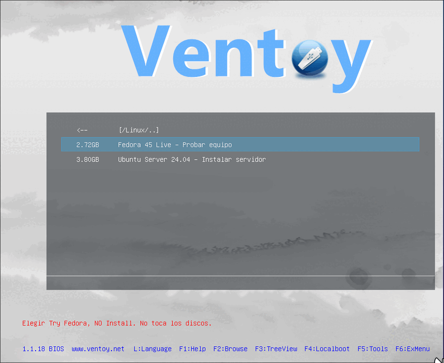
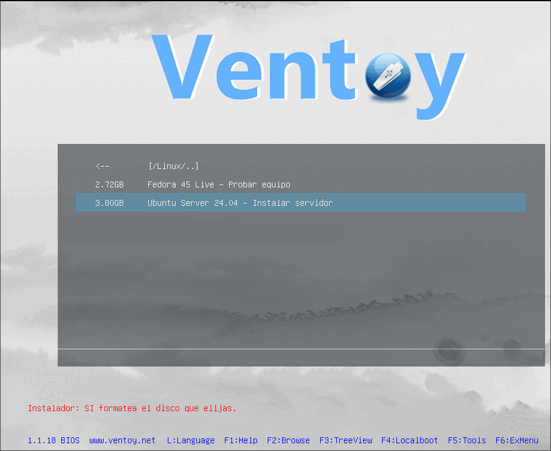
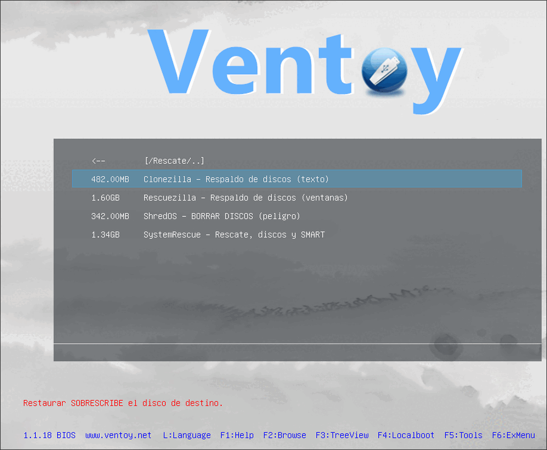
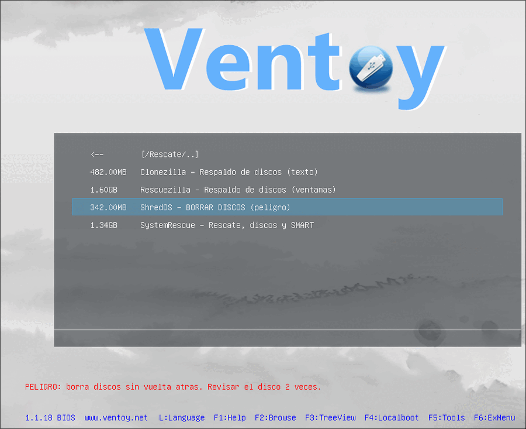
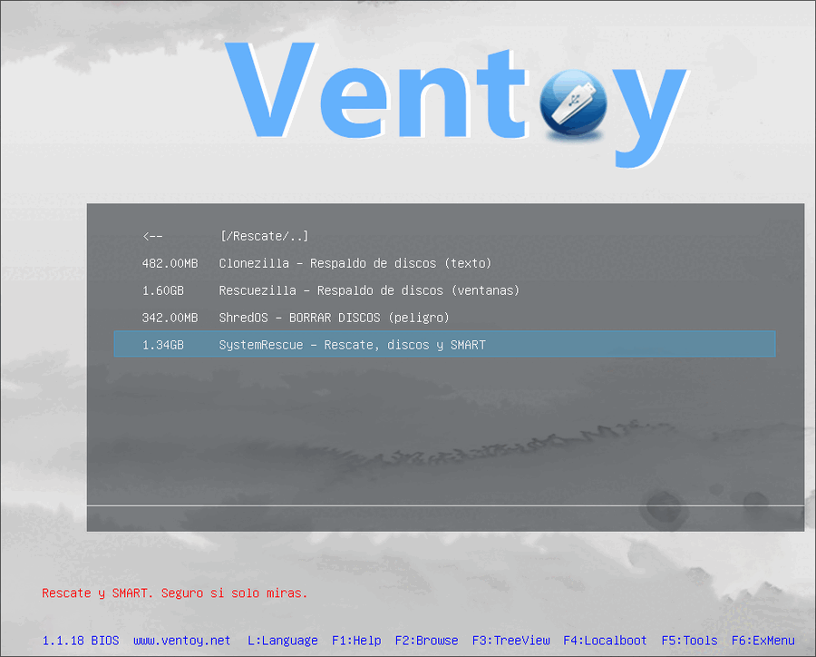

# 8. Probar la USB con QEMU (sin reiniciar)

Con QEMU puedes arrancar tu USB de Ventoy **dentro de una ventana**, como si fuera otra computadora. Sirve para revisar el menú, los nombres y los avisos de `ventoy.json` sin apagar tu equipo.

> [!IMPORTANT]
> La USB se conecta en **solo lectura** y la máquina virtual **no ve los discos de tu computadora**. Aunque abras ShredOS o Clonezilla ahí dentro, no pueden tocar nada real.

## 1. Instalar QEMU

```bash
sudo dnf install qemu-kvm        # Fedora
sudo apt install qemu-system-x86 # Ubuntu / Debian
```

## 2. Identificar la USB

```bash
lsblk -d -I 8,259 -o NAME,SIZE,MODEL,TRAN
```

Busca la línea con `TRAN = usb` (en estos ejemplos, `sda`). Cambia `sda` en los comandos siguientes si la tuya es otra.

## 3. Dar permiso de lectura a tu usuario

QEMU **no** se debe correr con `sudo`: en Wayland (Hyprland, GNOME…) la ventana no abre como *root*. En lugar de eso, dale a tu usuario permiso de **solo lectura** sobre la USB:

```bash
sudo setfacl -m u:$(whoami):r /dev/sda
getfacl /dev/sda
```

En la salida debe aparecer `user:<tu-usuario>:r--`. El permiso desaparece solo al desconectar la USB o reiniciar.

## 4. Arrancar

```bash
qemu-system-x86_64 -enable-kvm -m 2048 -drive file=/dev/sda,format=raw,readonly=on,if=virtio
```

| Parte | Qué hace |
|---|---|
| `-enable-kvm` | Usa la aceleración del procesador (va mucho más rápido). Si da error de permisos con `/dev/kvm`, quítalo. |
| `-m 2048` | Le da 2 GB de RAM a la máquina virtual. Para Fedora Live o Hiren's usa `-m 4096`. |
| `readonly=on` | La USB no se puede modificar. |
| `if=virtio` | Conecta la USB de una forma que sí acepta solo lectura (la forma por defecto da el error *Block node is read-only*). |

Para soltar el mouse de la ventana: **Ctrl+Alt+G**.

### Probar en modo UEFI (opcional)

Por defecto QEMU arranca en modo BIOS antiguo (abajo dirá `1.1.18 BIOS`). Las computadoras modernas usan UEFI. Para imitarlas:

```bash
sudo dnf install edk2-ovmf
qemu-system-x86_64 -enable-kvm -m 2048 \
  -drive if=pflash,format=raw,readonly=on,file=/usr/share/edk2/ovmf/OVMF_CODE.fd \
  -drive file=/dev/sda,format=raw,readonly=on,if=virtio
```

Abajo deberá decir `1.1.18 UEFI`.

## 5. Qué deberías ver: los avisos del menú

Al resaltar una ISO con las flechas (sin presionar Enter), aparece su aviso en **rojo** abajo de la pantalla. Los textos vienen de la sección `menu_tip` de [`ventoy.json`](../ventoy/ventoy.json).

| | |
|---|---|
| <br><sub>**Memtest86+**: solo prueba la RAM. Deja varias pasadas.</sub> | <br><sub>**Fedora Live**: elige *Try*, no *Install*.</sub> |
| <br><sub>**Ubuntu Server**: el instalador **sí formatea**.</sub> | <br><sub>**Clonezilla**: restaurar **sobrescribe** el disco destino.</sub> |
| <br><sub>**Rescuezilla**: mismo riesgo que Clonezilla al restaurar.</sub> | <br><sub>**ShredOS**: **peligro**, borra discos sin vuelta atrás.</sub> |
| <br><sub>**SystemRescue**: seguro mientras solo mires.</sub> | |

Si no aparece el aviso:

- Valida el JSON: `python3 -m json.tool /run/media/$USER/Ventoy/ventoy/ventoy.json`.
- Revisa que la ruta en `tips` sea **idéntica** a la de `menu_alias` (con `/` al inicio y las mismas mayúsculas).
- Si el texto queda encima de la barra de teclas, baja el valor de `"top"` (por ejemplo, de `88%` a `80%`).

## 6. ¿Puedo probar las herramientas dentro de QEMU?

**Sí arrancan, pero no sirven para diagnosticar.** La máquina virtual tiene hardware falso: memoria, disco y procesador simulados.

| Herramienta | ¿Arranca en QEMU? | ¿Sirve el resultado? |
|---|---|---|
| Menú de Ventoy, nombres y avisos | Sí | **Sí**: es para lo que sirve esta guía |
| Memtest86+ | Sí | No: prueba la RAM virtual, no la tuya |
| Fedora Live / SystemRescue | Sí (usa `-m 4096`) | Solo para practicar comandos; `smartctl` y `sensors` no tienen datos reales |
| Hiren's BootCD PE | Sí, lento (usa `-m 4096`) | Solo para conocer los menús; CPU-Z y CrystalDiskInfo muestran hardware virtual |
| Clonezilla / Rescuezilla / ShredOS | Sí | Solo para practicar con un disco falso (abajo) |
| Ubuntu Server | Sí | Sirve para practicar la instalación en un disco falso |

### Practicar con un disco falso

Para ver cómo funcionan Clonezilla, ShredOS o el instalador de Ubuntu **sin ningún riesgo**, crea un disco virtual vacío:

```bash
qemu-img create -f qcow2 /tmp/disco-prueba.qcow2 20G
qemu-system-x86_64 -enable-kvm -m 4096 \
  -drive file=/dev/sda,format=raw,readonly=on,if=virtio \
  -drive file=/tmp/disco-prueba.qcow2,if=virtio
```

Dentro de la máquina virtual, ese disco de 20 GB es el **único** que se puede borrar o instalar. Al terminar, bórralo con `rm /tmp/disco-prueba.qcow2`.

> [!CAUTION]
> **Nunca** agregues a QEMU un disco real de tu computadora (`/dev/nvme0n1`, `/dev/sdb`…) sin `readonly=on`. Ahí sí, ShredOS o el instalador podrían borrarlo.

Para diagnósticos reales, arranca la USB en el equipo físico (ver [guía 4](04-leer-diagnosticos.md) y [guía 7](07-ejemplos-terminal.md)).
